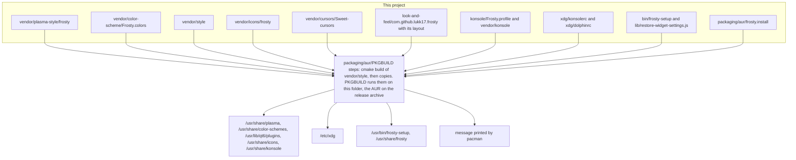
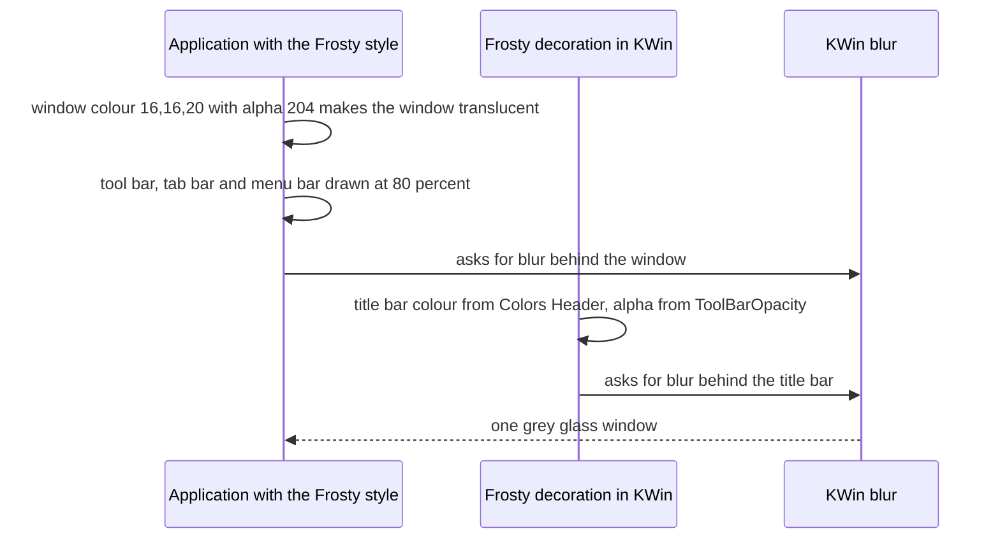
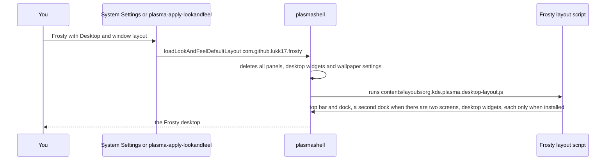

# Frosty

A frosted glass theme for KDE Plasma 6, packaged for Arch Linux as one package.

   

---

### What it is

Frosty turns Plasma into grey frosted glass: see-through panels, popups and windows with KWin blur behind them. It is a set of pieces that all carry the name Frosty, built from pinned copies of other free themes and installed together by one package:

1. The Plasma Style `frosty`, from the Layan Plasma Style with more see-through popups, panels and blurred widgets. Its window colour has the same alpha as the color scheme, so widgets that draw their own cards in that colour, such as KDE Control Station, are 80 percent glass too.
2. The color scheme Frosty, the Layan colors with a dark smoked window background that is about 20 percent see-through.
3. The application style and window decoration Frosty, a renamed copy of Darkly 0.5.41 with tool bars, tab bars, menu bars, the Dolphin sidebar, the Dolphin view, the Dolphin status bar and plain window areas at 80 percent and a blurred title bar. It is built into the package, so Darkly itself is not needed, and it can be installed next to the real Darkly.
4. The icon theme `frosty`: Infinity-Dark-Icons for system icons, candy-icons for the terminal, settings, system monitor and drive icons, Sours-Full-Color for keyboards, mice, phones, network cards and other devices, and a plain folder with a yellow to pink gradient for folders and Dolphin. Applications keep their own icons.
5. The Sweet cursors, under their own name `Sweet-cursors`.
6. The global theme `com.github.lukk17.frosty`, which selects all of the above at once. It has no splash screen of its own, so applying it switches the splash screen to the Breeze one.
7. A desktop layout inside the global theme: a top bar and a bottom dock, a second dock when a second screen is connected, and seven System Monitor widgets on the desktop. It is applied only when you ask for it.
8. The command `frosty-setup`, which saves a konsave backup of your desktop, installs the KDE Store widgets that the layout uses, asks before it replaces your panels, switches the desktop to Frosty and keeps the settings of the widgets you already had. `frosty-setup --undo` goes back to the desktop you had before.
9. Defaults for Konsole and Dolphin in `/etc/xdg`, the Konsole profile Frosty and the Konsole color scheme Frosty Green. Your own Konsole and Dolphin settings always win over these defaults.

It exists so that the whole look installs, updates and uninstalls with pacman, without copying files into the home folder.

---

### Install guide

#### What must already be installed

1. An Arch based system with KDE Plasma 6 on Wayland or X11. KWin blur must be on, which it is by default.
2. The `base-devel` group and `git`, for building packages.
3. paru, an AUR helper. On CachyOS it is in the normal repositories. On plain Arch, build it from its [AUR page](https://aur.archlinux.org/packages/paru).
4. Darkly is not needed. The Frosty style and decoration are built from their own copy of it.

On CachyOS, paru and the build tools install with:

```bash
sudo pacman -S --needed base-devel git paru
```

#### Widgets that Frosty uses

A widget that is not installed is skipped when the layout is applied, so the layout also works without it.

| Widgets | Comes from |
|---|---|
| Show Desktop, pager, task manager, Trash, keyboard layout | the `plasma-desktop` package |
| System Monitor charts, spacers, margins separator, system tray, Notifications, clipboard, disks and devices, camera indicator, input method, media player | the `plasma-workspace` package |
| Weather, keyboard indicator | `kdeplasma-addons` |
| KDE Connect | `kdeconnect` |
| Volume, network, battery and brightness, Bluetooth, display configuration | `plasma-pa`, `plasma-nm`, `powerdevil`, `bluedevil`, `kscreen` |
| Merkuro contacts in the system tray | `merkuro` |
| AppGrid, the launcher in the dock | the AUR package `plasma6-applets-appgrid`, a dependency of Frosty |
| KDE Control Station ([2196105](https://store.kde.org/p/2196105)), Compact Clock ([2366454](https://store.kde.org/p/2366454)), Dockio ([2185626](https://store.kde.org/p/2185626)), BatteryWatch ([2331781](https://store.kde.org/p/2331781)), AI usage ([2380133](https://store.kde.org/p/2380133)) | the KDE Store, installed by `frosty-setup` |

Frosty also depends on the AUR package `konsave`, which `frosty-setup` uses for the backup of your desktop.

#### Install from the AUR

Frosty is the AUR package [frosty](https://aur.archlinux.org/packages/frosty). paru builds it together with its two AUR dependencies, konsave and plasma6-applets-appgrid:

```bash
paru -S frosty
```

Then go on with step 3 of the steps below.

#### Steps to build from this folder

1. Install the two AUR dependencies. makepkg cannot install AUR packages by itself, paru can.

```bash
paru -S konsave plasma6-applets-appgrid
```

2. Open a terminal in this folder, then build and install Frosty. makepkg asks for your password to install the build tools and the package. When it is done, pacman shows a box that says one step is left.

```bash
makepkg -si
```

3. As your own user, not with sudo, and while you are logged in to Plasma, run:

```bash
frosty-setup
```

4. Answer the question, see [The question](#the-question).
5. Log out and in again, or close and open again every application that was already running, so they load the Frosty style.

#### What frosty-setup does

Every step prints one line that says what it does.

1. It notes your current global theme, so it can bring it back later.
2. It saves a backup of your desktop with konsave, named `frosty-backup-` with the date and time, for example `frosty-backup-20261022-153000`. konsave keeps it in `~/.config/konsave/profiles`. It also exports the same backup to a file in your home folder, for example `~/frosty-backup-20261022-153000.knsv`, and prints its path. If the backup fails, frosty-setup stops before it changes anything. Then it writes your global theme and the backup name to `~/.local/state/frosty/last-run`, or to `$XDG_STATE_HOME/frosty/last-run` when `XDG_STATE_HOME` is set, for `frosty-setup --undo`.
3. It installs the KDE Store widgets that are not installed yet. Widgets that are already there are left alone.
4. It asks the question below.
5. It switches your desktop to Frosty.
6. It prints the command that brings back your previous desktop: `frosty-setup --undo`.

#### The question

```text
Replace your panels and desktop widgets with the Frosty ones? Your backup is saved. (y/N)
```

1. Pressing Enter or typing n means No. Frosty changes only the look: colors, application style, Plasma Style, window decoration, icons and cursors. Your panels and desktop widgets stay as they are.
2. Typing y means Yes. Frosty applies its global theme with its layout. Plasma first deletes all your panels and desktop widgets and sets its default wallpaper, then builds the Frosty top bar, docks and desktop widgets. After that, frosty-setup copies your old settings from the backup into every new widget that you also had before, for example the accounts of the AI usage widget, BatteryWatch, the clock, the task manager and the system tray. When you had the same widget more than once, the first old one goes to the first new one, counted from the top panel, then the bottom panel, then the desktop, and from left to right. Old widgets that the Frosty layout does not have are listed as "not in Frosty". They are not added back, the backup still has them.

For scripts, `frosty-setup --yes` answers Yes and `frosty-setup --look-only` answers No without asking. Without a terminal to ask in, the answer is No.

#### What to check after

1. The top bar is at the top of the first screen and shows the clocks, the system tray and KDE Control Station.
2. The dock is at the bottom and Alt+F1 opens AppGrid.
3. With a second screen, a second dock is at the bottom of that screen. It hides when a window covers it.
4. The System Monitor widgets are on the desktop of the second screen, or of the only screen. If a GPU widget shows no values, open its settings and pick your GPU's sensor, see [Left out of the layout](#left-out-of-the-layout).
5. The AI usage widget still has your accounts.
6. Konsole opens with the Frosty profile and the Frosty Green colors, unless you had picked another default profile yourself.

#### How to go back

As your own user, not with sudo, run:

```bash
frosty-setup --undo
```

It reads the global theme and the backup name that the last frosty-setup run wrote to `~/.local/state/frosty/last-run`, shows the three steps below with these names, and asks once. After a y it runs the steps in this order and prints one line for each step:

1. It brings back your previous global theme with `plasma-apply-lookandfeel --apply`. konsave does not save the theme defaults that a global theme writes, so this step is needed for the old colors, icons and style.
2. It brings back the files of your backup with `konsave -a`.
3. It restarts Plasma with `systemctl --user restart plasma-plasmashell`, so it loads your old panels and widgets.

If a step fails, it stops there and says why. Fix the problem and run `frosty-setup --undo` again.

When there is no record, for example because frosty-setup never finished its backup, `frosty-setup --undo` says so and prints the same three commands. Run them yourself in this order with your own names. The names below are examples. `konsave -l` lists your backups, and frosty-setup printed your previous global theme in the line that starts with "Your current global theme is".

```bash
plasma-apply-lookandfeel --apply org.kde.breezedark.desktop
```

```bash
konsave -a frosty-backup-20261022-153000
```

```bash
systemctl --user restart plasma-plasmashell
```

`frosty-setup --undo` uses the names of the last run. If you ran frosty-setup more than once, the backup of the last run can already hold the Frosty desktop. To get the desktop you had before Frosty, run the three commands above yourself with the names of the first run: its backup is the oldest `frosty-backup-` name in `konsave -l`, and its global theme is in the line "Your current global theme is" that the first run printed. A widget that frosty-setup installed can show up in the system tray of your old desktop, because Plasma adds newly installed tray widgets by itself. Dockio does this. Remove it from the tray in the system tray settings.

To remove Frosty completely, go back first with `frosty-setup --undo`, then remove the package:

```bash
sudo pacman -R frosty
```

If you picked the Frosty profile as your own default in Konsole, pick another one in Settings, Manage Profiles. Your own settings for the Frosty style stay in `~/.config/frostyrc` after the package is removed. The widgets that `frosty-setup` installed stay too, and can be removed in Get New Widgets. The record `~/.local/state/frosty/last-run` and your backups stay as well.

There is no PowerShell version of these steps, because Plasma runs only on Linux and similar systems.

---

### The layout

1. Top bar, 30 pixels high, fills the screen width, does not float, translucent. From left to right: Show Desktop, a memory and a CPU pie chart, a GPU temperature pie chart, the virtual desktop pager, BatteryWatch, a flexible spacer, a margins separator, Compact Clock with the time, day and date, a 50 pixel spacer, Compact Clock with the date only, a flexible spacer, KDE Connect, Dockio, the system tray, Notifications, KDE Control Station and the AI usage widget.
2. Dock, 50 pixels high, floats, fits its content, translucent. AppGrid on Alt+F1, a margins separator, the task manager with System Settings, System Monitor, Konsole, the file manager and the web browser, another margins separator and the Trash.
3. Second dock, only when a second screen is connected: the same widgets, order and settings on that screen, and it hides when a window covers it. It has no Alt+F1, because one shortcut can open only one launcher.
4. Desktop widgets, on the second screen when it is connected and on the first screen otherwise: line charts for memory and swap, GPU power, GPU memory, GPU usage, GPU temperature, total CPU usage and CPU temperature, at the right edge of a 1920 by 1080 screen.

---

### Left out of the layout

These are left out on purpose:

1. The wallpaper. Plasma sets its default picture when the layout is applied.
2. The splash screen. Frosty has none, so Plasma uses the Breeze one.

These settings of the owner's desktop were not copied, because they hold personal data, usage history or state that the widgets write themselves:

1. The accounts list of the AI usage widget, which holds e-mail addresses and account and team ids. The layout starts it with no accounts, and `frosty-setup` copies your own accounts back from your backup.
2. The Gmail web app launcher in the dock, which belongs to one Chrome profile, and the owner's own applications: the Claude and Obsidian launchers in the dock, the Bitwarden entry in the system tray and the CachyOS Hello icon on the AppGrid button. AppGrid shows its own icon.
3. AppGrid's lists of known, recent and counted applications, its migration flags, and a `systemFavorites` key that AppGrid does not use.
4. The popup sizes and settings dialog sizes of every widget.
5. The `migrated` flags of the keyboard indicator and the volume widget.
6. The "show virtual devices" setting of the volume widget in the system tray. The layout script cannot change widgets inside the system tray reliably, see [docs/PLATFORM-NOTES.md](docs/PLATFORM-NOTES.md). Turn it on again in the settings of the volume widget.

Sensors that may need a pick on another computer:

1. The GPU usage and GPU memory widgets use the sensors for all GPUs, which every computer with a supported GPU has. With two GPUs they show the average usage and the total memory of both.
2. The GPU temperature and GPU power widgets on the desktop, and the GPU temperature pie chart in the top bar, use the first GPU (`gpu0`), because Plasma has these sensors only per GPU. On a computer with an integrated and a separate GPU the first one may be the integrated one. Pick the right GPU in the widget settings.
3. The CPU and memory sensors are the same on every computer. The CPU temperature has a value only when the computer reports CPU temperatures.

---

### frosty-setup

```bash
frosty-setup --help
```

1. It refuses to run as root, and pacman never runs it.
2. It needs a running Plasma session, because it talks to Plasma through its own scripting interface on D-Bus (`evaluateScript`). The old widget settings are copied into the new widgets while Plasma runs, so no restart is needed.
3. It is safe to run again. Each run makes a new backup and writes its names to the record for `frosty-setup --undo`, widgets that are installed are left alone, and the question is asked again.
4. Besides the konsave backup, its exported file and the record `~/.local/state/frosty/last-run`, it writes nothing itself. The KDE Store helper writes the widgets and its records in `~/.local/share/knewstuff3`, and Plasma writes its own settings.
5. Plasma writes widget settings to disk up to 10 seconds after a change. A setting changed in the last seconds before you run frosty-setup can be missing from the backup.
6. Settings of the widgets inside the system tray, such as "show virtual devices" of the volume widget, are not copied back, see [docs/PLATFORM-NOTES.md](docs/PLATFORM-NOTES.md).

---

### Konsole and Dolphin defaults

The package installs `/etc/xdg/konsolerc` and `/etc/xdg/dolphinrc`. Every KDE application reads its file in `/etc/xdg` first and the one in `~/.config` after it, so these are defaults for every user, and a value you set yourself always wins.

1. Konsole starts with the profile Frosty, which uses the color scheme Frosty Green, opens new tabs instead of new windows, closes a tab on a middle click and makes the tabs fill the tab bar.
2. Dolphin opens folders from other applications in a new tab, browses into archives, shows the full path in the location bar, and makes the tabs span the available width.

When you change `/etc/xdg/konsolerc` or `/etc/xdg/dolphinrc` yourself, pacman keeps your file on an update and writes the new one next to it as a `.pacnew` file.

---

### How it fits together



What happens to one window once the global theme is applied:



What happens when the layout is applied:



The color scheme is also installed inside the global theme as `contents/colors`, because Plasma looks up a scheme named in a global theme by a changed form of its name. [docs/PLATFORM-NOTES.md](docs/PLATFORM-NOTES.md) has the details behind this and the other choices.

---

### Features

1. Popups, panels and blurred desktop widgets are drawn 35 percent opaque, menus 96 percent, and there are no squares behind task manager buttons.
2. The background contrast effect of the Plasma Style is off, so widgets show the real blurred wallpaper.
3. The Frosty style and decoration use their own file names, plugin ids, config file `~/.config/frostyrc`, D-Bus names and C++ namespace, so the real Darkly can stay installed and keeps its own settings.
4. The global theme leaves your panels, widgets, wallpaper, fonts and window switcher alone, unless you ask for the layout.
5. The layout skips widgets that are not installed, so it never shows an error box in a panel, and it adds the second dock only when a second screen exists.
6. The Konsole and Dolphin defaults live in `/etc/xdg`, so they work for every new user without a script and never overwrite a user's own choice.
7. Every piece is a pinned copy of its upstream source, with each change listed in a CHANGES.md file and every source credited in [CREDITS.md](CREDITS.md).

---

### Compared with other ways

1. Picking each piece in System Settings gives the same look, but the pieces have to be found and installed one by one and are not updated by pacman.
2. The Layan global theme also ships a desktop layout and uses the Layan Aurorae decoration. Frosty uses its Darkly based decoration, and its layout is the owner's own top bar, docks and desktop widgets.
3. Kvantum with the Layan theme is the other common way to get see-through applications. Frosty uses Darkly's own opacity settings instead.
4. konsave saves and restores a whole desktop, personal settings included. The Frosty layout rebuilds the panels and desktop widgets without personal data.
5. Weaker points: the look depends on KWin blur. Applications that draw their own background, such as most GTK and Electron applications, stay opaque. Applying the global theme switches the splash screen to Breeze's. Applying the layout replaces desktop widgets and resets the wallpaper. Several widgets of the layout are not part of Frosty and must be installed separately. The desktop widget positions are fixed pixels for a 1920 by 1080 screen. The final look on screen has not been checked on a real desktop.

---

### Releasing a new version

A release makes the tag `v<version>`, a GitHub release with the package and the KDE Store archives, and the AUR update. The KDE Store upload stays manual.

1. Raise the version in every place that states it: `pkgver` in [packaging/aur/PKGBUILD](packaging/aur/PKGBUILD) with `pkgrel=1`, `Version` in both `metadata.json` files, `X-KDE-PluginInfo-Version` in [vendor/plasma-style/frosty/metadata.desktop](vendor/plasma-style/frosty/metadata.desktop), [vendor/style/VERSION](vendor/style/VERSION), the version badge at the top of this page and [.SRCINFO](.SRCINFO), which `makepkg --printsrcinfo > .SRCINFO` writes again. Add a section `### <version>, <date>, lukk17` to [CHANGES.md](CHANGES.md) and to the CHANGES.md of every component that changed.
2. Check that every place agrees. It prints the version or lists the places that differ:

```bash
packaging/version.sh
```

3. Commit and push to `main`.
4. Start the workflow Release on `main`, in the Actions tab of the repository or with the GitHub command line:

```bash
gh workflow run release.yml --ref main
```

5. The workflow stops when the tag already exists. Otherwise it runs the style tests, `reuse lint`, the package build, the AUR recipe build from a `git archive` and `namcap` in an Arch Linux container, makes the KDE Store archives, creates the tag and the GitHub release with the section of [CHANGES.md](CHANGES.md) as release notes, and pushes [packaging/aur](packaging/aur) to the AUR.
6. In git, `sha256sums` in [packaging/aur/PKGBUILD](packaging/aur/PKGBUILD) is a placeholder of 64 zeros, because the tag archive does not exist before the release. The AUR step runs `updpkgsums` on its copy after it downloads the new tag archive, so the AUR gets the real checksum and the zeros never reach it. A build from the placeholder fails the checksum check instead of building an unchecked archive.
7. The AUR step needs the repository secrets `AUR_USERNAME`, `AUR_EMAIL` and `AUR_SSH_PRIVATE_KEY`, the SSH key of the AUR account. Without `AUR_SSH_PRIVATE_KEY` the step is skipped with a warning, and the rest of the release still runs.
8. Open the run's summary page. Its KDE Store checklist names, for every store product, the archive file, the category, the version and the changelog to paste. Upload each archive by hand on [store.kde.org](https://store.kde.org).

---

### Documentation map

| Document | What it covers |
|---|---|
| [README.md](README.md) | This page |
| [CREDITS.md](CREDITS.md) | Every upstream source with its commit, date, license and authors |
| [CHANGES.md](CHANGES.md) | The change notices for the whole project |
| [vendor/plasma-style/CHANGES.md](vendor/plasma-style/CHANGES.md) | The changes to the Layan Plasma Style |
| [vendor/color-scheme/CHANGES.md](vendor/color-scheme/CHANGES.md) | The changes to the Layan colors |
| [vendor/style/CHANGES.md](vendor/style/CHANGES.md) | The changes to Darkly and the installed file names |
| [vendor/icons/CHANGES.md](vendor/icons/CHANGES.md) | Which icons come from where |
| [vendor/cursors/CHANGES.md](vendor/cursors/CHANGES.md) | The Sweet cursors copy |
| [vendor/konsole/CHANGES.md](vendor/konsole/CHANGES.md) | The Frosty Green Konsole color scheme |
| [look-and-feel/CHANGES.md](look-and-feel/CHANGES.md) | The global theme and its layout |
| [docs/PLATFORM-NOTES.md](docs/PLATFORM-NOTES.md) | Plasma, KWin, KConfig, ksystemstats, Darkly and makepkg facts behind the choices, with source references |
| [PKGBUILD](PKGBUILD) | The local build from this folder, which uses the AUR recipe |
| [.SRCINFO](.SRCINFO) | The metadata of [PKGBUILD](PKGBUILD) as makepkg prints it |
| [packaging/aur/PKGBUILD](packaging/aur/PKGBUILD) | How the package is built, the recipe published in the AUR |
| [packaging/aur/frosty.install](packaging/aur/frosty.install) | The message pacman prints after an install or upgrade |
| [packaging/version.sh](packaging/version.sh) | Checks that every place states the same version |
| [packaging/changelog.sh](packaging/changelog.sh) | Prints the section of one version from a CHANGES.md file |
| [packaging/ci.sh](packaging/ci.sh) | The release checks in an Arch Linux container: tests, reuse lint, package, AUR recipe, namcap |
| [packaging/store.sh](packaging/store.sh) | Makes the KDE Store archives and the upload checklist |
| [packaging/store](packaging/store) | The short credits file of each KDE Store archive |
| [.github/workflows/release.yml](.github/workflows/release.yml) | The release workflow |
| [.gitignore](.gitignore) | The build output kept out of git |
| [vendor/cursors/source](vendor/cursors/source) | The source of the Sweet cursors |
| [REUSE.toml](REUSE.toml) | The license and copyright of every file |
| [LICENSES](LICENSES) | The license texts |
| [vendor/style/LICENSE.MIT](vendor/style/LICENSE.MIT) | The MIT notice of the Darkly files with their copyright lines |
| [LICENSE](LICENSE) | The GNU GPL version 3 text, kept at the top for tools that look for it there |

---

### License

Frosty's own files are under the GNU General Public License version 3 or later. The copied pieces keep their licenses: GPL-3.0-only for the Layan, Infinity, candy-icons, Sours and Sweet files, GPL-2.0-or-later for the Konsole color scheme, GPL-2.0-or-later and MIT for the Darkly files, LGPL-3.0-or-later for the Breeze icons inside Infinity and LGPL-3.0-only for the GNOME icons inside Infinity. [REUSE.toml](REUSE.toml) gives the license of every file and [LICENSES](LICENSES) holds the texts. The package installs the GPL and LGPL texts, [CREDITS.md](CREDITS.md) and [vendor/style/LICENSE.MIT](vendor/style/LICENSE.MIT) in `/usr/share/licenses/frosty`, and every CHANGES.md in `/usr/share/doc/frosty`.
